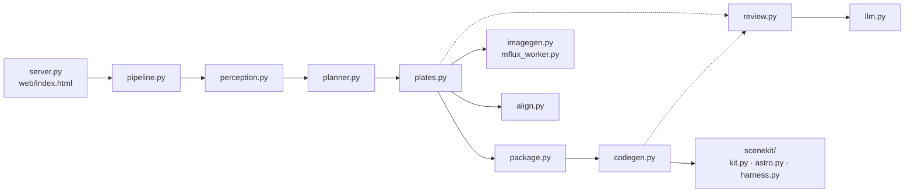

# Contributing

Thanks for helping. This page covers getting set up, how the code is organised, how to check a change actually helps,
and where help is most useful right now.

## Ground rules

1. **Local models only.** Every model call goes to Ollama, mflux or a Hugging Face model on this machine. No cloud
   AI APIs, and no Claude or other hosted agents inside the pipeline. (Open-Meteo, for geocoding and weather, is the
   only network service.)
2. **The live wallpaper stays AI-free.** Anything under `wallgen/scenekit/` must run with only numpy, OpenCV and the
   standard library, because it runs every 30 minutes on battery.
3. **Show the before and after.** For anything that changes images, attach before/after frames to your PR. "It
   looks better" without pictures isn't reviewable.
4. **Don't commit generated output.** `jobs/`, `.venv*`, renders and `*.png` under `compare/` are git-ignored. Keep
   it that way.

## Setup

Follow **Run it** in the [README](README.md). Then make one job you can reuse while you work:

```bash
.venv-gen/bin/python -m wallgen.pipeline --image templates/spring_clear_night.png --location "Chicago, US" --id dev
```

The Chicago painting in `templates/` is the regression scene. Every change should keep it working.

You can rerun just one stage. Delete that stage's `DONE` file (and the stages after it), then resume:

```bash
rm jobs/dev/05_renderer/DONE jobs/dev/06_finalize/DONE
.venv-gen/bin/python -m wallgen.pipeline --resume dev
```

Perception caches its vision outputs (`vision.npz`, `path_a.json`, `path_b.json`). Delete those too if you change
perception.

## Where things live



| File | Owns |
|---|---|
| `wallgen/config.py` | Every model name, threshold and loop limit. Start here. |
| `wallgen/pipeline.py` | Stage order, the fast preview, 4K finalize, and keeping the Mac awake while a job runs. |
| `wallgen/perception.py` | Vision models, the two reasoning paths, agreement, tie-break and masks. |
| `wallgen/planner.py` | Climate data → season phases (with a filter that keeps lying snow out of normal phases). |
| `wallgen/plates.py` | Image-edit prompts and review loop A. `align.py` lines generations up and locks structure. |
| `wallgen/review.py` | Automatic checks, the quick screen, the panel, merging issues, and routing fixes. |
| `wallgen/codegen.py` | Prompts for the code model, the safety and API checks, test moments, loop B. |
| `wallgen/scenekit/kit.py` | The rendering library the generated code calls: sky, sun and moon, clouds, lamps, water, weather. |
| `wallgen/live.py` | The runtime: renders a package for now with live weather and sets the wallpaper. |
| `wallgen/compare.py` | Benchmark against the hand-built Chicago version (about 1.5 h, uses the panel). |
| `wallgen/calibrate_screen.py` | Checks the quick screen against verdicts the panel already gave. |
| `tools/make_architecture.py` | Regenerates `docs/architecture.excalidraw` / `.svg` / `.png`. |

`dynamic_wallpaper.py`, `render/` and `templates/` are the **original hand-built Chicago wallpaper**. That's the one
currently installed, and it's the quality bar to beat. Leave it alone unless you're fixing it on purpose.

## Checking that a change helps

There's no unit test suite yet, so checks are end-to-end. Pick the check that matches what you touched:

| You changed… | Run | Look at |
|---|---|---|
| scenekit / rendering | `.venv/bin/python wallgen/live.py jobs/dev/04_package --at "2026-07-01 21:00" --no-set --out /tmp/a.png` (a few times and weathers) | the frames themselves |
| prompts, plates, align | delete `03_plates` onwards in `jobs/dev`, then resume | `03_plates/state.json` scores, and the plates themselves |
| review / thresholds | `.venv-gen/bin/python -m wallgen.calibrate_screen dev` | false accepts (the screen accepted, but the panel failed) must not go up |
| anything user-visible | `.venv-gen/bin/python -m wallgen.compare dev` | `compare/dev/summary.md` and the `sheet_*.jpg` files |

Before opening a PR, at least import everything:
`.venv-gen/bin/python -c "import wallgen.pipeline, wallgen.server, wallgen.calibrate_screen"`.

Review scores are noisy. The same image can get 3.8 one time and 5.0 the next, so trust what you see in the
images over a small change in score.

## Conventions

- **Stages are resumable.** Write outputs atomically (`common.write_json` and `os.replace`), mark the stage done only
  at the end, and skip work whose output already exists.
- **Model names live only in `config.py`.** Don't hard-code a model name anywhere else.
- **New kit functions must work for any scene.** Nothing about Chicago, lakes or lanterns should be assumed. A scene
  may have no sky, no water or no lamps. Update the `API` text in `codegen.py` so the code model knows the function
  exists.
- **Keep the code model sandboxed.** It may only import numpy, cv2, math and scenekit. Don't widen that list.
- Line length is 120, and comments say *why*, not *what*.
- If the architecture changes, update `tools/make_architecture.py` and the Mermaid diagrams in the README in the
  same PR.

## Good first things to work on

The biggest gaps right now, roughly in order of impact:

1. **Washed-out templates.** Generated season templates are greyer than the original. Try the cached Qwen-Image-2.1
   model, or more steps, in `imagegen.py` and `config.py`. Also add an automatic check in `review.py` that compares
   colour saturation against the original.
2. **Effects the toolkit lacks.** Lightning in storms, falling leaves and petals, snow settling on roofs and ground,
   and lamp reflections in water. Add them to `scenekit/kit.py` as general functions.
3. **Calibrate the review to a person.** Build a small page where someone rates 20 frames, then set
   `PASS_MEAN`, `SCREEN_ACCEPT_MEAN` and the other thresholds from those ratings.
4. **Install the generated wallpaper.** Add a "Set as my wallpaper" button that points the LaunchAgent at
   `wallgen/live.py` and the job's package.
5. **Tests.** Fast tests for `review.merge`/`passed`, `planner.validate`, `codegen.api_check` and
   `kit.Scene.phase_for` would catch most regressions without needing the GPU.

## Workflow

1. Branch from `main`, with a name like `fix/washed-out-templates`.
2. Keep each PR to one idea. Include before/after images and the numbers from the check you ran.
3. Open the PR against `main` on GitHub (`Preet0504/chicago-dynamic-wallpaper`) and ask Preet for a review.
