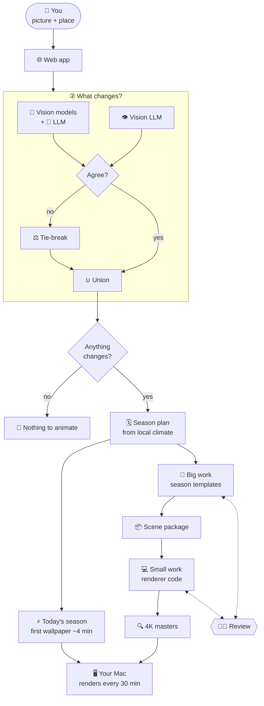
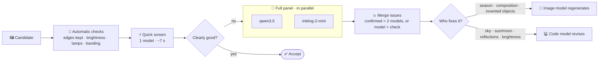
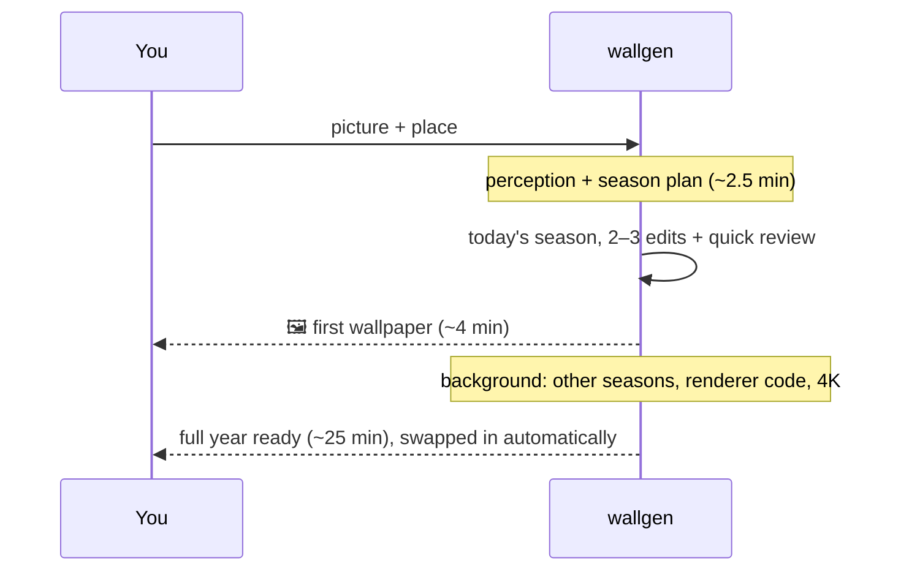

# wallgen: any picture + a place → a living wallpaper

Upload a picture and say where it is. wallgen works out what in the picture changes with weather and time, such as
the sky, trees, a lake, street lamps or snow on roofs. It then builds a wallpaper that follows that place for real:
the sun and moon in the right position and phase, clouds, rain, fog, storms, snow, the seasons, and lamps that switch
on at dusk.

- **Everything runs locally on a Mac.** It uses local vision, language, code and image models (Ollama, mflux,
  Hugging Face). There are no cloud AI calls.
- **The live wallpaper itself uses no AI.** It is a fast procedural render (about 1 s per 4K frame) from a scene
  package that the models build once.
- **You get a first wallpaper in about 4 minutes.** The rest of the year keeps building in the background (about
  25 minutes).

Full system diagram (editable): [docs/architecture.excalidraw](docs/architecture.excalidraw). Open it at
[excalidraw.com](https://excalidraw.com) or with the VS Code Excalidraw extension. There is also a preview:
[docs/architecture.png](docs/architecture.png).

---

## How it works



| Stage | What happens | Local models |
|---|---|---|
| ① Upload | Web app or CLI. Every job is a folder `jobs/<id>/`, and every stage can be resumed after a crash. | – |
| ② Perception | Two independent paths list the things that change with weather or time. **A:** segmentation, detection and depth models, then a language model reasons over the list. **B:** a vision LLM looks at the picture itself. The paths must agree (Jaccard ≥ 0.6). A third model settles disputes, and the union is kept. If nothing changes, you get a message instead. | Mask2Former, Grounding DINO, SAM, Depth Anything · qwen3:8b · qwen3.5:122b · inkling-2-mini |
| ③ Season plan | The place is geocoded, and 3 years of daily climate are used to split the year into visual phases for *that* place. Snow appears only where it actually lies. | gpt-oss:120b |
| ④ First wallpaper | Only today's season is built (2–3 image edits), with a quick review. It is rendered for "now" with live weather. | FLUX.2-klein, qwen3.5 |
| ⑤ Big work | A day and a night template for every phase. Each one is lined up with the original, and its buildings and objects are locked to the original. Review loop A. | FLUX.2-klein |
| ⑥ Small work | A code model writes `scene_renderer.py` against `scenekit`: sky, sun and moon, clouds, lamps, reflections, rain, fog and snow. It is checked against the real API, then rendered in a sandbox for 6 test moments. Review loop B. | gpt-oss:120b |
| ⑦ Finalize | 4K masters (today's season first), a 24-hour preview strip and a report. | SeedVR2 |

### Review: the part that decides quality

Every template and every test frame goes through the same review. A quick screen can **only accept**. Anything doubtful
goes to the full panel, and only the panel can fail an image.



Loops stop when an image passes (mean ≥ 3.6/5, no metric below 2.5, no confirmed severity-3 issue), when a round
stops improving, or after 2 rounds in fast mode (3 in `--full`). The best attempt always wins.

### Progressive delivery



---

## Run it

**You need:** an Apple-silicon Mac with **128 GB** of memory (the review models are 81 GB and 20 GB and run side by
side), about **210 GB** of free disk for model weights, Python 3.13, [Ollama](https://ollama.com) and
[uv](https://docs.astral.sh/uv/).

```bash
# 1. models
ollama pull qwen3.5:122b && ollama pull inkling-2-mini:26b-a5b && ollama pull gpt-oss:120b && ollama pull qwen3:8b
uv tool install mflux                       # FLUX.2-klein edits + SeedVR2 upscaling (weights download on first use)

# 2. environments
python3 -m venv .venv-gen && .venv-gen/bin/pip install -r requirements-gen.txt   # pipeline + web app
python3 -m venv .venv && .venv/bin/pip install numpy opencv-python-headless      # tiny runtime for the live render

# 3. go
.venv-gen/bin/python -m wallgen.server                  # http://127.0.0.1:8765, then upload a picture + a place
```

Without the web app:

```bash
.venv-gen/bin/python -m wallgen.pipeline --image photo.png --location "Kyoto, JP"    # fast mode (default)
.venv-gen/bin/python -m wallgen.pipeline --image photo.png --location "Kyoto, JP" --full   # exhaustive: panel reviews everything
.venv-gen/bin/python -m wallgen.pipeline --resume <job id>                           # continue after a crash
```

Render a finished scene for a moment, or for right now with live weather:

```bash
.venv/bin/python wallgen/live.py jobs/<id>/04_package --at "2026-12-24 17:30" --no-set --out frame.png
.venv/bin/python wallgen/live.py jobs/<id>/04_package          # renders now and sets it on every display
```

All settings are in [wallgen/config.py](wallgen/config.py): models, review thresholds, loop limits and which test
moments are used.

### What a job leaves behind

```
jobs/<id>/
  01_perception/   scene.json (objects + who found them) · masks.npz · depth.npy · overlay.jpg
  02_plan/         plan.json (phases, start dates, snow rule, lamp threshold)
  03p_preview/     now.jpg - the first wallpaper
  03_plates/       every attempt, its scores and the reviewers' issues (state.json)
  04_package/      the scene package: manifest.json · plates/ · plates4k/ · layers.npz · scene_renderer.py · scenekit/
  05_renderer/     every code version, its test frames and review history
  06_finalize/     report.json · day_strip.jpg
```

The **scene package** (`04_package/`) is all the live wallpaper needs. It runs with just numpy and OpenCV.

---

## Status

Working end to end on this Mac and tested on the Chicago scene from a cold start. These numbers are from that test,
not a promise:

| | |
|---|---|
| First wallpaper | 3 min 46 s |
| Full year (12 templates, renderer, 4K) | ~25 min in the background |
| Template review | 5–17 s with the quick screen, ~60–80 s when escalated to the panel |
| Live render | ~1.2 s per 3840×2160 frame |

**Known gaps** (details in [CHALLENGES.md](CHALLENGES.md)):

- **Quality is not yet at hand-tuned level.** Against a hand-built version of the same scene, the reviewers preferred
  the hand-built one: 4.12 vs 3.90, and 34 of 48 blind votes. Generated templates come out less saturated, the
  autumn colour is weak and snow doesn't settle on roofs.
- **Reviewers are lenient and noisy.** Thresholds have not yet been calibrated against a person's ratings.
- **Installing the generated runtime as the login wallpaper is still manual.**

Want to help? Read [CONTRIBUTING.md](CONTRIBUTING.md).
